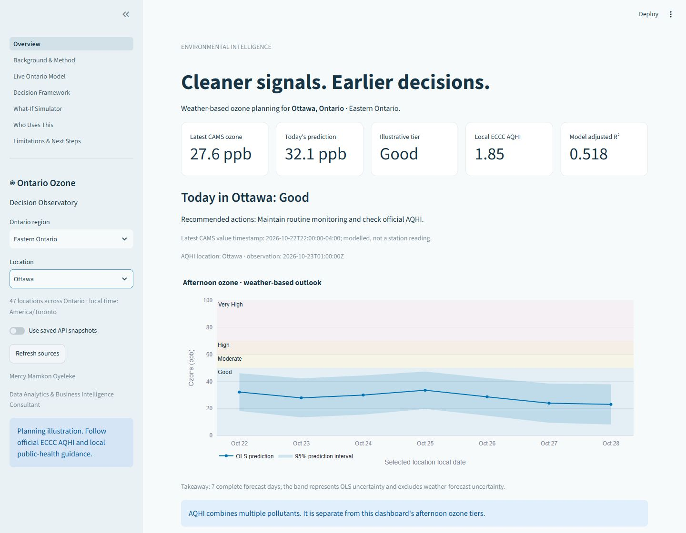
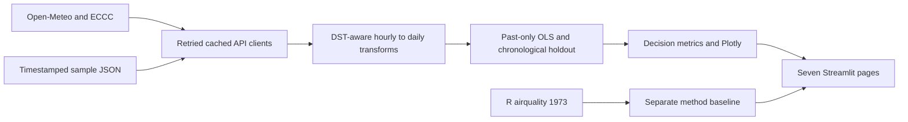

# AIR QUALITY ANALYSIS RESEARCH ANALYSIS

## Ontario air quality — Power BI Desktop and reproducible Python analysis

   [](https://github.com/mamkon/air-quality-analysis-research-analysis/actions/workflows/ci.yml) 

**Live Python app:** _Add your Streamlit Community Cloud URL after deployment._ GitHub CI has passed Ruff and all 96 tests on Python 3.11.

**Power BI Desktop:** open [AIR QUALITY ANALYSIS RESEARCH ANALYSIS.pbip](powerbi/AIR%20QUALITY%20ANALYSIS%20RESEARCH%20ANALYSIS.pbip), keeping the adjacent report/model folders together. See the [Power BI guide](powerbi/README.md) for opening, refreshing and saving a standalone `.pbix`. The native report contains seven editable pages, 23 import tables and 40 DAX measures. It uses a dated, portable research snapshot; the Python/Streamlit application is the live API version.

**Verification status:** native JSON schemas and exported scenario arithmetic pass validation. The installed Desktop application remained blank when opening the project, so report rendering and a standalone `.pbix` are not yet verified. See [Power BI verification](docs/powerbi_verification.md).

**GitHub repository:** [mamkon/air-quality-analysis-research-analysis](https://github.com/mamkon/air-quality-analysis-research-analysis).

This research uses weather data to estimate afternoon ozone in 47 Ontario locations. It asks a practical question: can weather patterns help teams prepare for days when ozone may be higher?

### Why this subject, and who could use it?

This research focuses on **air quality and public-health planning** to turn environmental data into information that can support practical planning. Ontario was selected to make the work relevant to communities across the province. Comparing 47 locations shows local differences instead of treating the whole province as one place. Ground-level ozone was selected because weather helps explain how it forms and moves. Sunlight helps gases in the air react to form ozone; temperature and wind also matter. See [ECCC's explanation](https://www.canada.ca/en/environment-climate-change/services/air-quality-health-index/weather.html).

| Industry or team | Example use of air-quality data |
|---|---|
| Public health | Prepare messages using official air-quality advice |
| Hospitals | Explore links with breathing-related visits using separate patient data |
| Schools and childcare | Check official AQHI when planning outdoor activities |
| Construction and outdoor employers | Review outdoor work timing and breaks alongside official guidance |
| Government and environmental consulting | Compare locations and identify monitoring needs |
| Transport and city planning | Study outdoor exposure using additional local data |
| Pharmacies and suppliers | Compare air-quality patterns with actual sales before changing stock |
| Insurance and risk teams | Add environmental context to wider risk studies |

These are possible uses of this type of data. They are not claims that organisations use this dashboard or that the project has proved these benefits.

### How the weather helps prediction

This research demonstrates my skills in preparing data, finding patterns, checking predictions and explaining results. Multiple linear regression was selected as a clear starting method because its results can be explained and reviewed. It does not prove cause and effect or guarantee the best possible forecast.

The model learns a pattern from past **temperature, wind speed, sunlight energy and ozone** for the same location and day. It uses the three weather inputs together to estimate afternoon ozone. The model then uses forecast weather to make an estimate for a future day.

For example, it checks the pattern learned from previous warm, sunny days, together with wind. Sunshine alone does not guarantee high ozone. Emissions and pollution arriving from elsewhere also matter. This research checks predictions against a later part of the past data that was kept out of training.

Ontario training ozone comes from CAMS through Open-Meteo: these are model estimates, not direct station readings. The project predicts ozone, not hospital visits or individual illness. The 1973 New York data explain the method only; recent Ontario data train the modern models. Use official AQHI and local advice for health decisions.

Read the [plain-English guide](docs/plain_language_guide.md) for examples and simple definitions. Technical details follow below.

### Key findings — generated from saved real-source data

- Historical baseline: **111 complete cases**, adjusted R² **0.595**.
- Modern Toronto model: **90 complete days**, adjusted R² **0.437**.
- Chronological holdout RMSE: **7.39 ppb**. At the illustrative 60 ppb cutoff, the holdout contains **0 event days**; unsupported recall is undefined.

These are dated snapshot findings, not promised live performance. Regenerate them with `python scripts/build_docs.py`; inspect [computed evidence](docs/results.json) and [live verification](docs/live_verification.json).



### Business question

Can temperature, wind and solar radiation predict high-ozone days well enough to trigger early public-health action, and what should decision-makers do? The dashboard supports evaluation of that question; it does not claim the current model is ready to issue alerts.

### Sources and attribution

| Source | Endpoint / provenance | Use |
|---|---|---|
| R airquality | `statsmodels.datasets.get_rdataset('airquality', 'datasets')`; [R documentation](https://stat.ethz.ch/R-manual/R-devel/library/datasets/html/airquality.html) | NYC May–September 1973 method demonstration |
| Open-Meteo weather forecast | `https://api.open-meteo.com/v1/forecast` | hourly `temperature_2m,wind_speed_10m,shortwave_radiation`, `past_days=7`, `forecast_days=8`, `wind_speed_unit=kmh` |
| Open-Meteo weather archive | `https://archive-api.open-meteo.com/v1/archive` | explicit start/end dates, same variables; ends five days before request date to accommodate reanalysis lag |
| Open-Meteo / CAMS air quality | `https://air-quality-api.open-meteo.com/v1/air-quality` | hourly `ozone`, `past_days=92`, `forecast_days=5`; modelled concentrations, not station measurements |
| ECCC MSC GeoMet | `https://api.weather.gc.ca/collections/aqhi-observations-realtime/items` and `aqhi-forecasts-realtime/items` | Exact selected `location_id`, `f=json`, `limit=1000`; `latest=true` for observations; latest forecast publication retained separately |

The selector covers **47 Ontario locations across 6 regions**, including all 41 Ontario areas listed by ECCC AQHI plus Kenora, Dryden, Sioux Lookout, Timmins, Moosonee and Fort Severn. These are representative point estimates, not continuous station coverage of every address. Official AQHI is shown only for the matching configured ECCC area; the six additional communities explicitly show AQHI as unavailable. No Toronto value is substituted.

All Open-Meteo requests use `timezone=UTC,timeformat=unixtime` then convert epochs to the selected location's IANA time zone. Western locations such as Kenora use America/Winnipeg. `data/ontario_locations.json` stores coordinates, region, time zone, AQHI area ID and retrieval time, loaded through `src/config.py`. Original city-centre weather points are retained for the first five locations; other official areas use ECCC point coordinates. Weather grid cells and AQHI monitoring areas are distinct spatial supports.

Metadata sources: [ECCC AQHI stations](https://api.weather.gc.ca/collections/aqhi-stations?f=json) and [Open-Meteo geocoding / GeoNames](https://open-meteo.com/en/docs/geocoding-api). Refresh and review with `python scripts/build_locations.py`. Station filters replace the previous Toronto bounding-box query, avoiding mixed stations and truncated province-wide result sets. The core forecast, archive, ozone and AQHI endpoints remain the same; the expansion adds station-catalogue and geocoding metadata endpoints.

Official documentation checked: [forecast](https://open-meteo.com/en/docs), [historical weather](https://open-meteo.com/en/docs/historical-weather-api), [air quality](https://open-meteo.com/en/docs/air-quality-api), [ECCC observations](https://api.weather.gc.ca/collections/aqhi-observations-realtime?f=json), [ECCC forecasts](https://api.weather.gc.ca/collections/aqhi-forecasts-realtime?f=json).

No endpoint replacement was necessary. Implementation adaptations: UTC epoch conversion for DST, archive-to-forecast gap filling, and explicit recognition that CAMS is modelled data. Open-Meteo's keyless free API is for non-commercial use and has usage limits; assess provider terms before commercial deployment. Attribution: Open-Meteo and CAMS / Copernicus, CC BY 4.0; ECCC Open Government Licence – Canada. The project code is MIT; source data retain their original terms.

### Methodology

1. Demonstrate missing-data sensitivity, Pearson/Spearman correlation, Shapiro–Wilk, simple/multiple OLS, VIF, residual and Q–Q diagnostics on historical data. Complete cases are the primary baseline; imputation is descriptive sensitivity analysis.
2. Aggregate modern weather into local daily maximum temperature (°C), mean wind (km/h), total shortwave radiation (MJ/m²/day). Each hourly radiation mean is multiplied by 0.0036. Require complete local days, including 23/25-hour DST days.
3. Define daily ozone as the mean of local hourly samples at 13:00, 14:00 and 15:00, requiring all samples. Convert µg/m³ to ppb by dividing by 1.96, assuming 25°C and 1 atm. The API's hourly sampling is an approximation to the historical afternoon measurement window.
4. Join on local day; use only dates before today, at most the latest 90 complete cases. Never score modern SI inputs with the historical °F/mph/Langleys model. Narrow-band historical Langleys are not treated as equivalent to modern broadband radiation.
5. Hold out the latest quarter chronologically. Refit the deployment OLS on all past days. Held-out residuals drive confusion matrices and rolling seven-day RMSE. Archive weather validation is retrospective, not a test against archived forecast vintages.
6. Show raw 95% individual prediction intervals. Negative values expose OLS limitations rather than being silently clipped. Log-response AIC/BIC, R² and RMSE are explicitly on a different scale and not ranked against raw-response statistics.

**Missing-data reconciliation:** mean-imputed historical OLS uses 153 rows with R² 0.480; the requested primary analysis uses 111 complete cases. The [computed comparison](docs/baseline_sensitivity.csv) includes mean/median alternatives, coefficients and the number of filled ozone responses. These approaches change sample composition and variability, so their training R² values do not establish comparative predictive skill. Filled responses are never used as live validation targets. The **Background & Method** page and reproducible notebook expose this distinction.

API calls are cached one hour for live data and one day for archive/baseline data. Requests have bounded timeouts and retries. Every city has genuine timestamped JSON snapshots, plus derived daily CSVs; API errors display a fallback banner. Snapshot dates are never shifted to today. If saved forecasts expire, the overview shows current predictions as unavailable while historical analysis and the simulator remain usable. Snapshot refresh is an explicit maintenance command; the app never overwrites committed files.

### Decision framework

Illustrative afternoon-mean tiers: Good <50; Moderate 50–<60; High 60–<70; Very High ≥70 ppb, configurable in `src/config.py`. Public-health messaging, hospital capacity, school activities, outdoor work, city operations and pharmacy stock each have an accountable decision-maker and success measure.

The [2025 Canadian CAAQS](https://ccme.ca/en/air-quality-report) ozone standard is 60 ppb; [US EPA NAAQS](https://www.epa.gov/ground-level-ozone-pollution/ozone-national-ambient-air-quality-standards-naaqs) is 70 ppb. Both are based on the three-year average of the annual fourth-highest daily maximum eight-hour average. The dashboard target and tiers do not establish compliance or replace official AQHI guidance.

Prioritise recall during screening design because missed events can harm vulnerable groups; weigh false-alarm fatigue and operational cost with partners. The slider explores held-out behaviour, not an independently validated choice of policy. False-alarm rate means FP/(FP+TN); zero denominators remain missing. No health outcome data are used to quantify benefit.

### Who uses this

Public health and hospitals can assess communications and respiratory capacity planning. Government/environment, ESG consulting, insurance, utilities, urban planning/transit and pharmacy teams can examine monitoring, exposure and preparedness workflows. The **Who Uses This** page maps example organisations and job titles to evidence of skills; these are illustrative, not endorsements or current vacancies.

### Architecture



`app/` owns navigation and page scripts; `src/` owns configuration, API, transforms, models, decisions and charts. `tests/fixtures/` holds real JSON fixtures. `scripts/` refreshes snapshots, verifies live behaviour and generates README findings. `notebooks/analysis.ipynb` reproduces the baseline; `docs/` contains evidence and the screenshot.

`powerbi/` holds the native PBIP project, PBIR report pages, TMSL semantic model, DAX measures and CSV evidence. Rebuild with `python scripts/build_powerbi.py`; validate native JSON with `python scripts/validate_powerbi.py`. Power BI's in-app Refresh reloads the embedded snapshot, while new API data and retraining require the documented Python refresh/rebuild workflow.

### Run locally

```bash
python -m venv .venv
# Windows: .venv\Scripts\activate
# macOS/Linux: source .venv/bin/activate
pip install -r requirements.txt
streamlit run app/streamlit_app.py
```

Choose a city and page in the sidebar. Use **Use saved API snapshots** for deterministic offline exploration. `AIR_QUALITY_OFFLINE=1` also disables API calls. Set it before starting Streamlit. Refresh cached calls with the sidebar button. The Windows development environment blocked a newer PyArrow DLL; a compatible PyArrow 19 series is pinned, and targeted statsmodels imports avoid loading unused state-space binaries. Local verification used the bundled Python 3.12 runtime; CI targets the requested Python 3.11.

```bash
python scripts/snapshot.py --refresh-all # explicitly refresh real-source JSON
python scripts/build_docs.py     # regenerate findings and daily CSVs
python scripts/verify_live.py    # opt-in network integration test
```

### Deploy on Streamlit Community Cloud

To publish the optional live Python app, create an app in Streamlit Community Cloud from this GitHub repository. Set the entry point to `app/streamlit_app.py` and select Python 3.11 in advanced settings. Deploy, verify source timestamps, then replace the live-link placeholder above. Core functionality requires no API key. The Power BI Desktop report can be opened locally independently of Streamlit.

### Testing

```bash
pytest -q
ruff check .
```

Default tests need no internet: source JSON mocks cover every API, including outage fallback; known-value tests cover conversion, daily energy, missing-hour gates, DST, model fitting, chronological isolation and alert boundaries. Streamlit AppTest executes every page and the entry point with APIs disabled. `scripts/verify_live.py` checks live retrieval for all configured Ontario locations, every page and entry routing; its dated evidence is saved in `docs/live_verification.json`. CI runs pytest and ruff on pushes and PRs. Local results are recorded in `docs/verification.md`.

### Limitations and next steps

Correlation is not causation. Omitted emissions, traffic, humidity and transport, modelled ozone, short seasonal training windows, missingness, serial dependence and weather forecast error limit operational use. An interval conditional on OLS assumptions is not a calibrated health-risk bound. Training R² is not an alert-readiness measure.

Next: station-level ECCC validation, rolling-origin forecast evaluation, governed ER-outcome linkage, SARIMAX and gradient-boosting comparisons, calibrated alerts and opt-in notifications. Check official AQHI and local public-health advice for real health decisions.

### Skills demonstrated

API integration and resilience; pandas time alignment and unit discipline; statistical inference and diagnostics; chronological model validation; accessible Plotly/Streamlit communication; decision analytics; reproducible testing and CI; transparent limitations.

**Author:** Mercy Mamkon Oyeleke, Data Analytics & Business Intelligence Consultant · [LinkedIn — add profile URL](https://www.linkedin.com/)
