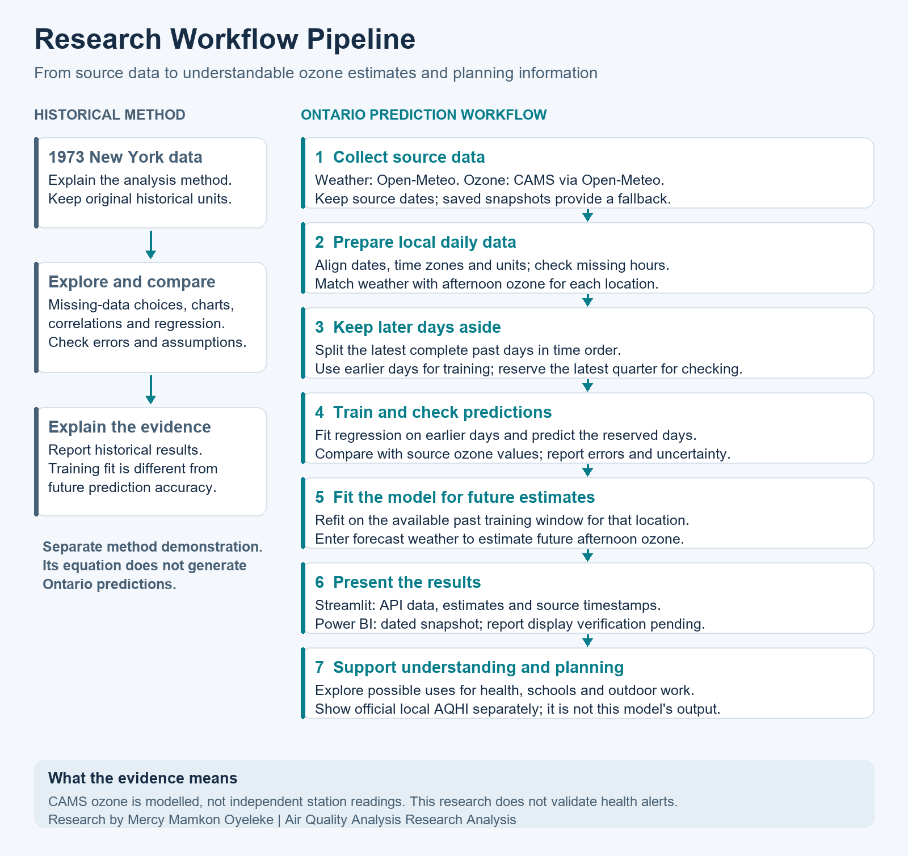

# Understanding this research

**Research by Mercy Mamkon Oyeleke, Data Analytics & Business Intelligence Consultant.**

## Research aim and objectives

This research examines how temperature, wind speed and sunlight relate to ground-level ozone, and whether these relationships can help estimate afternoon ozone in selected Ontario locations.

The objectives are to understand the data, explain missing-data choices, explore weather and ozone relationships, compare regression methods, check predictions on later days, and explain practical uses and limitations.

See the [full research outline](research_outline.md) for the reasons, research questions and section plan.

## Research Workflow Pipeline

The image shows how this research moves from source data to estimates and planning information. The historical method is separate from the Ontario prediction model.

## Why air quality in Ontario?

This research focuses on environmental analytics and public-health planning. Its purpose is to turn weather and ozone data into information that is easier to understand and use for planning.

This research focuses on Ontario to make the analysis relevant to communities across the province. Comparing 47 selected locations allows the dashboard to show local differences instead of treating all of Ontario as one place. These locations do not cover every address.

The research also demonstrates my skills in preparing data, finding patterns, checking predictions and explaining results through a dashboard.

This research estimates afternoon ground-level ozone, one part of air pollution. Ozone was selected because its connection with weather provides a clear question to investigate: can temperature, wind and sunlight help estimate its level? Weather helps explain ozone patterns. Sunlight helps gases in the air react to form ozone. Temperature and wind also affect its formation and movement. See [ECCC's explanation](https://www.canada.ca/en/environment-climate-change/services/air-quality-health-index/weather.html) and [Ontario's report](https://www.ontario.ca/document/air-quality-ontario-2022-report/key-air-contaminants).

## Which industries could use these data?

These are possible uses of air-quality data, not claims that organisations use this dashboard or that its benefits have been proved.

| Industry or team | How the data could help |
|---|---|
| Public health | Prepare messages using official air-quality advice |
| Hospitals | Explore links between poor air and breathing-related visits, with separate patient data |
| Schools and childcare | Check official AQHI when planning sports and outdoor play |
| Construction and outdoor employers | Review outdoor work timing and breaks alongside official guidance |
| Government and environmental consulting | Compare locations and decide where more monitoring is needed |
| Transport and city planning | Study exposure around routes and outdoor waiting areas using additional local data |
| Pharmacies and suppliers | Compare air-quality patterns with actual sales before changing stock |
| Insurance and risk teams | Add pollution context to studies using suitable exposure and claims data |

## How does it help prediction?

This research matches past weather with ozone values from the same place and day. The model uses three inputs together:

- Temperature: how hot the day gets.
- Wind speed: how quickly air moves. Wind can disperse pollution or bring it from elsewhere.
- Sunlight energy: how much solar energy reaches the ground during the day.

Multiple linear regression was selected because it is a clear starting method: it shows how each weather input relates to ozone while considering the other inputs. This makes the results easier to explain and review. It does not prove cause and effect or guarantee the best possible forecast. The method finds a numerical pattern between these inputs and afternoon ozone. The model then uses forecast weather to estimate ozone for that location. For example, the model uses the pattern learned from past warm, sunny days, together with wind, to estimate ozone under similar forecast conditions. Warm sunshine alone does not guarantee high ozone: emissions and pollution arriving from elsewhere matter too.

This research keeps the most recent part of the past data out of training, then compares predictions with those source values. This checks how well the model estimates days it did not learn from. The shaded chart range shows uncertainty under the model's assumptions; it is not a guarantee.

## What are the limits?

Ontario training ozone comes from CAMS through Open-Meteo. These are air-quality model estimates, not direct station readings. The model learns to estimate that source's afternoon ozone. Checking predictions against independent station readings is a future step.

New York data from 1973 explain the method only. Recent Ontario data train separate models for the selected locations.

This research estimates ozone levels, not hospital visits, individual illness or medicine sales. Those questions need extra data and testing. Use official AQHI and local advice for health and outdoor activity decisions.

## Useful words

| Term | Everyday meaning |
|---|---|
| Domain | The subject area |
| Predictor | Information used to make an estimate, such as temperature |
| Target | The value being estimated: afternoon ozone |
| Correlation | Two things change together; this does not prove cause and effect |
| Regression | A method for finding a numerical relationship between inputs and an outcome |
| Holdout data | Past days kept out of training to check predictions |
| RMSE | A measure of prediction error in ozone units; lower is better on the same test data |
| ppb | Parts per billion, a unit for ozone concentration |
